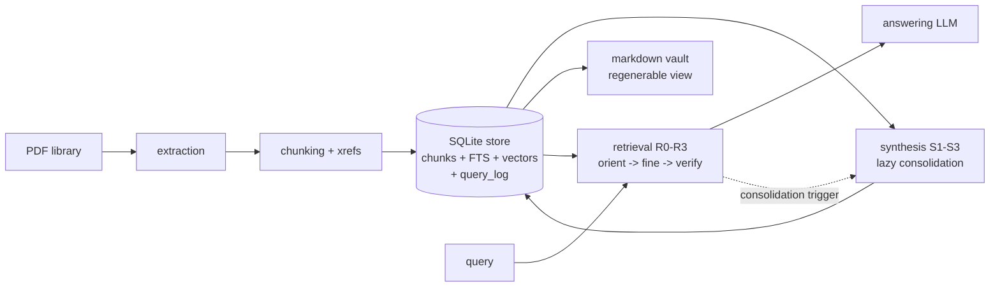

# Architecture

Two products, one substrate. The retrieval index and the wiki vault are built from the same canonical chunk store and never duplicate content: notes reference chunk IDs, retrieval returns chunk IDs, the vault is rendered from the store.

## Memory model

Four layers (details in docs/synthesis.md), inspired by gist/verbatim memory and usage-driven consolidation:

- **L0 verbatim**: canonical chunks + section tree + native cross-references. Deterministic, no LLM.
- **L1 gist**: document/section summaries. Cheap, at ingest.
- **L2 concepts**: keyword notes with typed grounded links. Built lazily, consolidated by use.
- **L3 atlas**: overview map, hub pages. Periodic.

Associations, in order of reliability: the **embedding space** (free, primary), the **native structural graph** (section adjacency + explicit xrefs, exact, extracted without LLM), and **semantic wikilinks** (cautious, typed, grounded; navigation and vault value, experimental as a retrieval channel — D10).

## Data flow

- **Ingestion** (left) runs per document as idempotent jobs; each stage reads and writes only through the store.
- **Query** (right) is stateless with respect to ingestion, but leaves traces: `query_log` rows and consolidation triggers, which drive background synthesis. This is the one deliberate feedback edge in the system.

## Components and responsibilities

| Component | Owns | Must not |
|---|---|---|
| `storage` | SQLite schema, chunk/note/link/xref tables, FTS5, vector index, query log, vault export, job state | contain pipeline logic |
| `extraction` | PDF → ordered sections of clean text (TOC-aware, heuristics fallback) | call LLMs |
| `ingestion` | stage runner, chunking, xref extraction, enrich (open research) | write files outside the store |
| `synthesis` | summaries, lazy keyword notes, consolidation policy, atlas | invent content not grounded in chunk references |
| `retrieval` | orient, hybrid search, RRF, rerank, graph (exp.), verify/repair, assembly | know about providers or prompts |
| `agent` | R3 loop: tools + stop criteria | bypass retrieval/store primitives |
| `llm` | client protocol, Gemini impl, key pool, cost metering, local embedder/reranker | contain domain prompts |
| `eval` | gold datasets, S×R×budget grid, blind judge, reports | — |
| `cli` | KB lifecycle, ingest, query/chat, export, costs, eval commands | contain business logic |

## Key contracts

**Chunk identity.** Stable across re-runs on the same source: derived from `(doc_id, structural path, ordinal)`. Details in [storage.md](storage.md).

**LLM output discipline.** LLM-calling stages receive numbered references and return references + newly written prose, never copies of source text.

**KB handle.** Every operation takes a `KnowledgeBase` object (paths + open store + config), constructed in exactly one place.

**S/R independence.** Retrieval branches on *what exists in the store* (notes? links? overview?), never on the configured S level. Any R works on any S.

**Retrieve small, read big.** Search units are small chunks; context units are their section windows. The chunker guarantees the former, assembly the latter.

## Concurrency model

Single-writer per KB: ingestion (and background consolidation) hold the write lock; queries are read-only and concurrent (SQLite WAL). Local CPU work runs as jobs, not ad-hoc threads sharing mutable stores. Query-time writes (query_log, consolidation queue) go through a short-lived writer transaction.
