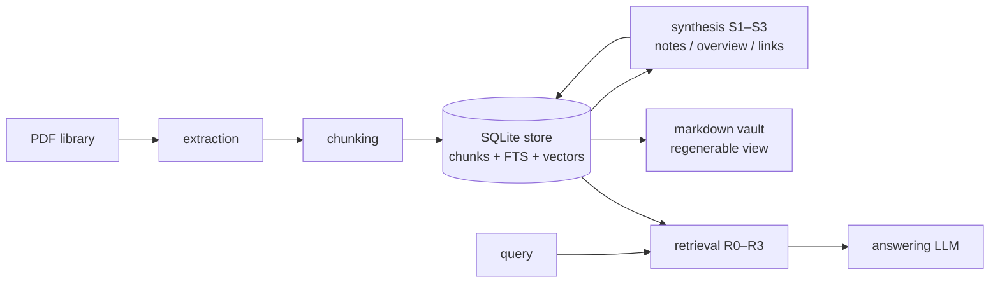

# Architecture

Two products, one substrate. The retrieval index and the wiki vault are built from the same canonical chunk store and never duplicate content: notes reference chunk IDs, retrieval returns chunk IDs, the vault is rendered from the store.

## Data flow

- **Ingestion** (left half) runs per document as idempotent jobs; each stage reads and writes only through the store.
- **Query** (right half) is stateless with respect to ingestion; it sees whatever structures the KB's S level produced and exploits what exists.

## Components and responsibilities

| Component | Owns | Must not |
|---|---|---|
| `storage` | SQLite schema, chunk/note/link tables, FTS5 index, vector index, vault export, job state | contain pipeline logic |
| `extraction` | PDF → ordered sections of clean text (TOC-aware, heuristics fallback) | call LLMs |
| `ingestion` | stage runner, job scheduling/resume, pluggable stage implementations | write files outside the store |
| `synthesis` | keyword notes, overview, link curation; everything the S slider adds above S0 | invent content not grounded in chunk references |
| `retrieval` | lexical + dense search, RRF fusion, reranking, graph expansion, context assembly under budget | know about providers or prompts |
| `agent` | R3 loop: tool definitions (search / read note / follow links / read chunks) and stop criteria | bypass the retrieval component's search primitives |
| `llm` | provider-agnostic client protocol, Gemini impl, retries, key pool, cost metering | contain domain prompts |
| `eval` | gold datasets, ablation runners, blind judge, reports | — |
| `cli` | KB lifecycle, ingest, query, export, eval commands | contain business logic |

## Key contracts

**Chunk identity.** A chunk ID is stable across re-runs on the same source file: derived from `(doc_id, structural path, ordinal)`, not from content hashes alone (content-identical chunks in different places are distinct). Details in [storage.md](storage.md).

**LLM output discipline.** Any ingestion/synthesis stage that calls an LLM receives numbered references (chunk IDs, keyword IDs) and returns **references + newly written prose**, never copies of source text. This is the single rule that killed the most complexity in v1.

**KB handle.** Every operation takes a `KnowledgeBase` object (paths + open store + config), constructed in exactly one place. No function signatures accumulating loose dicts and paths.

**S/R independence.** Retrieval code branches on *what exists in the store* (are there notes? links? an overview?), never on the configured S level. This is what makes any R work on any S.

## Concurrency model

Single-writer per KB: ingestion holds the write lock; queries are read-only and can run concurrently (SQLite WAL mode). Background local work (embedding) runs in-process as jobs, not as ad-hoc threads sharing mutable stores.
