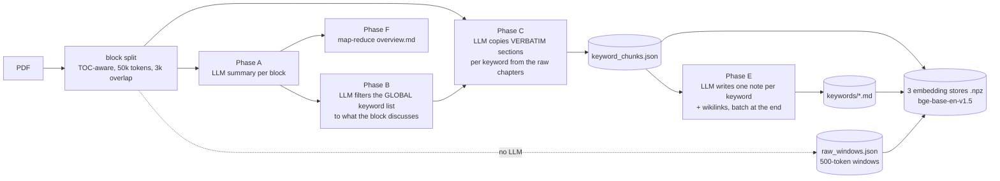

# WikiRAG v1 and why v2 exists

This note is self-contained: it describes what WikiRAG v1 was, what it measured, and which of its problems v2 is built to remove. v1 lives in its own repository, which is private (branch `master` is the reference; `branch-di-presentazione` is the snapshot used for the course presentation). Nothing in v2 depends on it at runtime.

## Timeline

| Date | What happened |
|---|---|
| 2026-05-13 | v1 starts as a university NLP course project: a RAG system over PDF libraries built through the Gemini API |
| 2026-07-01 | a large tabletop RPG rulebook collection ("Ars Magica") becomes the reference corpus |
| 2026-07-10 | v1 gets its benchmark suite; the final 480-cell run is the evidence behind v2 |
| 2026-07-11/13 | final-presentation branch of v1 (`branch-di-presentazione`) |
| 2026-08-30 | v2 plan written (this repository, plan only) |
| 2026-08-31 | v2 implementation by waves starts |

## v1 in one page

**Idea.** The knowledge base is organised by **keyword**, not by document. Instead of indexing "what page 47 of document X says", v1 indexes "what is known about concept K across every document that mentions it". Each keyword gets (a) one text chunk per source document and (b) a wiki-style note synthesised from all its chunks, with `[[wikilinks]]` to related keywords. Several independent knowledge bases can coexist (`knowledge_bases/<name>/`).

**Ingestion** (Gemini for the heavy steps, everything else local):

- **Block split.** `pdf_extractor.py` reads the PDF structure with PyMuPDF (table of contents, font-size heuristics as fallback); `processing_blocks.py` builds chapter-aware blocks.
- **Phase A.** One LLM call per block produces dense notes (a summary).
- **Phase B.** The LLM is given the summary and the **global** keyword list and must select the relevant ones (and add genuinely new ones). Reusing existing keywords keeps the vocabulary from splintering into synonyms. Guardrails catch the model copying the whole list back.
- **Phase C.** On smaller sub-blocks of the *raw* chapters, the LLM extracts, per selected keyword, the full section where it is discussed, **copied verbatim** into a JSON object.
- **Phase E.** Keywords touched by a run go in a persistent pending queue; once the batch is done, one LLM call per keyword synthesises a note from all its chunks and links it to other known keywords.
- **Phase F** (run on demand). `overview.py` builds a single high-level map note (`overview.md`) with a two-level map-reduce over the Phase A summaries.
- **Raw windows.** Independently of all the above, the source text is cut into 500-token sliding windows (100 overlap) and embedded. No LLM decides what is in them; they are the lossless backstop.
- **Maintenance.** `--forget` a document, `--recover-orphans` (promote or strip wikilinks pointing at concepts that never became keywords), `--rebuild-embeddings`, `--regenerate-keywords`.

**Retrieval** (`retriver.py`, `query_classifier.py`, `chat.py`):

1. A light LLM **query classifier** reads the question, the recent chat and `overview.md`; for "complex" questions it returns up to 5 sub-questions that become extra retrieval anchors, and the token budget is doubled.
2. Per anchor: **hybrid keyword search** (fuzzy name match + IDF-weighted embedding similarity, each min-max normalised), plus independent **chunk search** and **raw-window search**.
3. **Graph expansion** along the wikilinks of the top keywords' notes, giving "peripheral" keywords.
4. **Context assembly** under the token budget, by priority: a merged, score-ranked pool of chunks and raw windows (per-keyword cap and text de-duplication) → keyword notes → peripheral keyword names. `overview.md` is prepended to every query.

**State on disk.** `keywords_map.json`, `keyword_chunks.json`, `raw_windows.json`, `pending_keywords.json`, `overview_parts.json`, the note folder and three `.npz` embedding stores with JSON metadata: six-plus coupled files kept consistent by hand-written `sync_*` functions.

## What v1 measured

The v1 benchmark (`benchmark/` in the v1 repo) is the most valuable thing it produced. 30 gold questions on the Ars Magica corpus (15 simple, 15 complex), a **blind LLM judge** scoring 0-30 (correctness 12, completeness 12, groundedness 6), four systems and four token budgets (480 judged cells):

| System | What it is |
|---|---|
| `tier_zero` | raw windows only, no classifier |
| `base` | raw windows + the query classifier (budget doubling, sub-questions) |
| `mid` | raw windows + Phase A summaries, with classifier |
| `full` | the whole keyword pipeline, with classifier |

Mean score (0-30) over all 30 questions:

| Budget (tokens) | tier_zero | base | mid | full |
|---|---|---|---|---|
| 1,000 | 11.1 | 12.4 | 14.7 | 15.2 |
| 2,500 | 15.0 | 20.3 | 20.9 | 21.2 |
| 10,000 | 22.4 | 24.7 | 25.7 | 24.4 |
| 20,000 | 25.2 | 25.8 | 26.8 | 26.1 |

The run's own noise threshold is about **3 points**: with 15 questions per subset, smaller differences between systems at the same budget are not a winner.

What this says:

- At realistic budgets (10k-20k tokens) the whole spread between raw windows alone and the full keyword pipeline is 1.6 to 3.3 points, and `full` never beats `mid` or `base` by more than noise.
- Where the keyword pipeline looked better than raw windows (small budgets), most of the gain is the **classifier doubling the budget** on complex questions (`base` vs `tier_zero` on complex questions at 2,500 tokens: 20.1 vs 11.1), not the keyword layer.
- `full` initially lost to the naive baselines in every aggregate cell because chunks filled the budget first; it took two rounds of fixes (merged score-ranked pool, per-keyword cap, text de-duplication) to get it within noise of `mid`.
- Four questions (9 cells) stayed out of reach for any ranking fix: the needed fact was diluted inside a 500-token raw window with unrelated text, so it never entered the candidate pool (verified on one of them, where the answer was a small table merged with a page of narrative).

## Why v2 exists

The conclusion v1 forced: **the keyword/wiki layer's real product is a readable vault, not better retrieval**. Paying one LLM call per keyword per run for retrieval quality that a cheap index matches was the wrong trade, and several costs of the design were incidental, not essential:

| v1 problem | Evidence | v2 decision |
|---|---|---|
| LLM asked to **copy source text verbatim** (Phase C) | JSON escaping failures, typographic-quote workarounds, repair and retry machinery, the same passage extracted under several keywords and needing de-duplication at query time | **Chunks are canonical** and produced deterministically and locally; LLM stages return references and new prose, never copies of source text (D3) |
| State in 6+ coupled JSON files | hand-written `sync_*` reconciliation after every mutation, including pruning of stale vectors | One **SQLite** database per KB (content, links, FTS5, usage, job state); the markdown vault is a regenerable view (D4) |
| Embeddings **silently truncated** | `bge-base-en-v1.5` has a 512-token window and unbounded chunk concatenation exceeded it | A single embedding model whose window is read by the chunker, chunks sized to fit (D14: `bge-m3`, also multilingual for Italian queries over English books) |
| Retrieval relied on keyword matching and raw cosine | no reranker; facts diluted below reach in 500-token windows | Retrieval floor of BM25 + dense + RRF + cross-encoder rerank, "retrieve small, read big" (D2, D12) |
| Cost of synthesis paid upfront for every keyword | Phase E is one call per keyword per run, with no measured retrieval gain | **Usage-driven consolidation**: notes are built lazily and in the background, driven by what is actually asked (D11); synthesis becomes a slider (S0-S3) |
| Wikilink graph used as a retrieval channel | graph expansion never shown to help; orphan links to concepts that were never keywords | Graphs demoted to navigation and human product; links are typed and grounded, chosen from an embedding-shortlisted candidate list so orphans are impossible by construction (D10) |
| Keyword filter prone to runaway | Phase B sometimes returned nearly the whole global list; guardrails with retries and hard caps | Tagging picks from an embedding-shortlisted candidate list instead of free LLM filtering |
| No cost visibility | token counts per call only: no price table, no totals per stage | Every LLM call goes through a metering wrapper; `wikirag costs` |
| Pipeline fixed at one setting | cheap and expensive were never separable | Two independent sliders: synthesis `S` (per KB) and retrieval depth `R` (per query), each step measured against the S0/R0 floor |

## What carries over from v1

v2 deliberately has **no backwards compatibility** with v1 data (D8): knowledge bases are re-ingested from scratch. What is ported or kept:

| v1 asset | In v2 |
|---|---|
| `benchmark/` (blind judge, ablation grid) | `wikirag/eval/harness.py` (judge prompt and rubric unchanged) |
| `benchmarks/arsmagicaV2/dataset.json` (30 gold questions) | same path, kept out of git because it quotes the corpus ([benchmarks/README.md](../benchmarks/README.md)) |
| `query_classifier.py` (28/30 correct on the gold set) | `wikirag/retrieval/router.py`: decomposition at `R2`; its depth auto-routing function is not wired to the CLI yet |
| `GeminiPipeline.py` (retries, backoff) | `wikirag/llm/gemini.py` |
| `pdf_extractor.py` heuristics | `wikirag/extraction/pdf.py` |
| `prompts.json` | not reused: v2 prompts live next to the stage that uses them and return references, not copies of text |
| Raw windows as a lossless backstop | the chunk store itself is lossless, with section windows for context |

For the design in detail, continue with [architecture.md](architecture.md) and [decisions.md](decisions.md).
